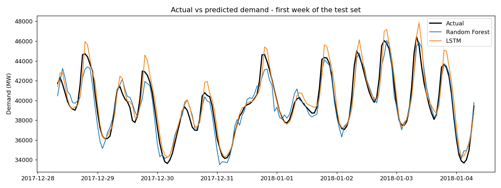
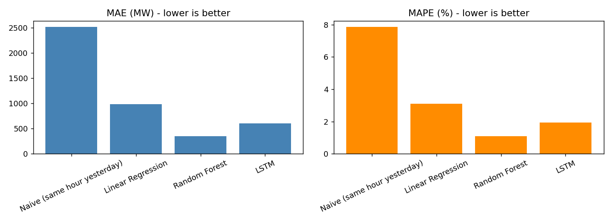
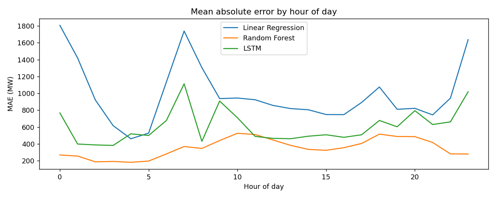

# Short-Term Electricity Load Forecasting: LSTM vs Machine Learning Baselines

Forecasts the next hour of electricity demand from past demand and calendar features, and compares a deep learning model (LSTM) against simpler baselines.

## Problem
Utilities need accurate short-term demand forecasts for generation scheduling and grid planning. This project builds an end-to-end Python pipeline for hourly load forecasting and evaluates it on unseen, later-in-time data.

## Dataset
- **PJM Hourly Energy Consumption** (PJME region), hourly demand in MW, from Kaggle:
  https://www.kaggle.com/datasets/robikscube/hourly-energy-consumption
- Download `PJME_hourly.csv` and place it next to `forecast.py`. The file is not stored in this repo because of its size.
- The most recent 35,000 hours are used by default.

## Approach
1. **Cleaning:** sort by time, remove duplicate timestamps, fill missing hours by interpolation.
2. **Features:** hour, day of week, month, weekend flag, demand 1 hour / 24 hours / 168 hours ago, and the previous 24-hour rolling mean.
3. **Split:** time-based, 70% train / 15% validation / 15% test. No random shuffling, so the models never see the future.
4. **Models:** Naive baseline (same hour yesterday), Linear Regression, Random Forest (scikit-learn), and an LSTM (TensorFlow/Keras) that reads the previous 24 hours. Scaling is fitted on training data only.
5. **Evaluation:** MAE, RMSE and MAPE on the test set.

## Results

| Model | MAE (MW) | RMSE (MW) | MAPE (%) |
|---|---|---|---|
| Naive (same hour yesterday) | 2516.95 | 3378.73 | 7.85 |
| Linear Regression | 984.64 | 1254.85 | 3.10 |
| Random Forest | 352.31 | 481.74 | 1.08 |
| LSTM | 607.11 | 769.44 | 1.94 |

**Observations:** Random Forest performed best (MAPE 1.08%), followed by the LSTM (1.94%), Linear Regression (3.10%) and the naive baseline (7.85%). The Random Forest used lag, rolling-mean and calendar features, while the LSTM only saw the previous 24 hours of demand and was trained for 8 epochs without extensive tuning. Adding calendar features to the LSTM input and tuning it further are the next steps.





Full results: `metrics.csv` and `predictions.csv`.

## How to run
```bash
pip install -r requirements.txt
python forecast.py --data PJME_hourly.csv
```
Optional flags: `--epochs 5` (faster LSTM training), `--skip-lstm` (baselines only), `--last-n 20000` (less data).

## Limitations and future work
- Uses a single region and no weather or holiday features.
- The LSTM is a small single-layer model and was not extensively tuned.
- Forecasts only one hour ahead; multi-step horizons would be a natural extension.
- Possible next steps: add temperature data, tune the models, and serve the best model through a simple API.

## Tech stack
Python, NumPy, pandas, scikit-learn, TensorFlow/Keras, Matplotlib
